# OMNI_GUARD Software Design Specification (SDS) v1.0

**Status:** Living Document  
**SINGLE SOURCE OF TRUTH**  
**Project Name:** OMNI_GUARD  
**Lead Embedded Systems Architect:** OMNI_GUARD Engineering  
**Confidentiality:** Enterprise Engineering Document

---

## Part I — Executive Summary

### 1. Vision
To redefine perimeter security through the integration of decentralized hardware intelligence and centralized mobile AI, creating a seamless, autonomous security ecosystem that is both accessible and professional.

### 2. Mission
OMNI_GUARD aims to provide high-fidelity threat detection and response by leveraging multi-sensor fusion, low-latency communication protocols, and generative AI to bridge the gap between complex hardware and human-centric interfaces.

### 3. Objectives
*   **Reliability:** Achieve 99.9% uptime for hardware-software synchronization.
*   **Intelligence:** Eliminate false positives using multi-frame target validation.
*   **Scalability:** Provide a modular architecture for future drone and robotics integration.
*   **Usability:** Deliver a professional, real-time command center interface.

### 4. Project Scope
The OMNI_GUARD ecosystem encompasses an Android-based command center, an ESP32-powered high-speed radar sensor unit, and an Arduino-based physical authority unit. It covers everything from local hardware control to cloud-assisted AI analysis.

### 5. Product Overview
OMNI_GUARD is an AI-powered smart security platform. It monitors perimeters using ultrasonic/radar sensors, tracks intruders via laser-guided turrets, and provides physical and digital alerts.

### 6. Target Markets
*   Residential Smart Homes
*   Industrial Perimeters
*   Tactical Surveillance Operations
*   Incubation & Prototyping Labs

### 7. Business Value
By integrating off-the-shelf high-performance hardware with custom synchronized firmware and a robust Android engine, OMNI_GUARD offers a professional security solution at a fraction of the cost of traditional proprietary systems, while remaining fully expandable.

---

## Part II — Current System Architecture

### 1. Android Application
The **Command Center**. Built using Kotlin, Jetpack Compose, and Hilt. It manages all state, processes AI intents, hosts a Ktor server for telemetry, and handles Bluetooth/WiFi connectivity.

### 2. AI Assistant
Integrated **OpenAI Engine**. Uses GPT-4o-mini to analyze system history, current telemetry, and user voice commands. It provides natural language briefings and executes structured hardware commands.

### 3. ESP32 Sensor Unit
The **Tactical Radar**. An ESP32-C6 WROOM unit utilizing dual ultrasonic sensors on a high-speed servo sweep. It performs multi-target tracking, velocity estimation, and laser-guided turret acquisition.

### 4. Arduino House Unit
The **Hardware Authority**. An Arduino UNO R3 that maintains the master state for Power, Armed, and Alert modes. It provides local physical feedback (LCD, LEDs, Buzzer) and handles manual button overrides.

### 5. Backend
**Internal Ktor Server** hosted natively within the Android app. Exposes RESTful endpoints (`/sensor_v8`, `/arduino`) for near-real-time JSON telemetry from the ESP32.

### 6. Communication Protocols
*   **Bluetooth Classic (9600 Baud):** Android ↔ Arduino (Commands, ACKs, Status packets).
*   **WiFi (HTTP POST JSON):** ESP32 ↔ Android (Rich telemetry snapshots).
*   **HTTPS:** Android ↔ OpenAI (Natural language processing).

### 7. Internal Data Flow
1.  **Sensors** detect objects → **ESP32** filters and builds target list.
2.  **ESP32** POSTs JSON to **Android Ktor Server**.
3.  **Android** updates **Security Repository** and **UI State**.
4.  **Android** issues commands to **Arduino** via **Bluetooth**.
5.  **Arduino** updates physical hardware and returns **STATUS** packet.

---

## Part III — Complete Feature Documentation

### 1. Android Application Functionality
*   **Tactical Radar:** 180° visualization of detections with persistence and threat-level color coding (Cyan -> Yellow -> Orange -> Red).
*   **Security Dashboard:** Real-time metrics including Distance, Angle, Connection Quality, Latency, and Power states.
*   **Mission Log:** Persistent Room database recording system events, hardware ACKs, AI commands, and security breaches with source/severity tagging.
*   **Command Queue:** Deterministic flow with 3x automatic retries and synchronization verification.

### 2. AI & Voice System
*   **Voice Command Interpreter:** Fuzzy matching for "Arm", "Disarm", "Start Scan", "Emergency", etc.
*   **State-Aware Briefing:** AI reads current `SystemStatus` before speaking to ensure accurate information.
*   **Voice Confirmation:** System only confirms actions after receiving hardware `ACK`.

### 3. House Unit Features
*   **State Authority:** The master switch for Arming and Power.
*   **LCD Interface:** 16x2 I2C display with caching to prevent flicker. Displays Distance and Mode.
*   **Non-Blocking Alarm Driver:** Multi-pattern LED and Buzzer logic that remains responsive during alerts.
*   **Watchdog:** Hardware watchdog resets unit if firmware hangs for >2s.

### 4. Sensor Unit Features
*   **Multi-Target Tracking:** Concurrent tracking of up to 5 targets with unique IDs.
*   **Proportional Turret:** Smooth laser movement using velocity prediction.
*   **Hysteresis Machine:** Prevents "flipping" between threat levels at boundary distances.
*   **WiFi Recovery:** Automatic reconnection loop for robust link stability.

---

## Part IV — Communication Protocol

### 1. Bluetooth Protocol (V7.1)
*   **CMD Packet:** `CMD:<COMMAND>\n` (e.g., `CMD:ARM\n`).
*   **ACK Packet:** `ACK:<COMMAND>\n` or `ACK:BUTTON_<COMMAND>\n`.
*   **STATUS Packet:** `STATUS:POWER=1,ARMED=1,MUTED=0,AUTOSCAN=1,STATE=READY,DISTANCE=35,REDLED=0,GREENLED=1,BUZZER=0,VERSION=7.1\n`.
*   **EVENT Packet:** `EVENT:BUTTON_ARM\n`.

### 2. WiFi/HTTP Protocol (V8.1)
**Endpoint:** `POST /sensor_v8`
**Payload Example:**
```json
{
  "type": "SENSOR_UPDATE",
  "version": "8.1",
  "telemetry": { "heap": 124000, "rssi": -65, "threat": 3, "state": 2 },
  "sensor": { "dist": 35, "angle": 45, "turret": 48, "target_id": 102 },
  "targets": [
    { "id": 102, "d": 35, "a": 45, "c": 85 }
  ]
}
```

### 3. Synchronization Logic
1.  **Handshake:** On connection, Arduino sends `HOUSE_UNIT_ONLINE`.
2.  **Sync:** Android responds with `CMD:VERSION` and `CMD:PING`.
3.  **Loop:** Arduino sends `STATUS` every 1000ms. Android sends `CMD:PING` every 5000ms.

---

## Part V — Hardware Documentation

### 1. Current Components
*   **Controller:** ESP32-C6 (160MHz Dual Core) & Arduino UNO R3.
*   **Connectivity:** HC-05 Bluetooth, Integrated WiFi 6.
*   **Sensing:** 2x HC-SR04 Ultrasonic (Median Filtered).
*   **Actuation:** 2x MG90S Micro Servos.
*   **Feedback:** 16x2 I2C LCD, 5V Active Buzzer, High-Intensity LEDs.

### 2. Future Supported Hardware
*   **Primary Sensor:** HLK-LD2410 mmWave Radar (Presence Detection).
*   **Verification:** VL53L1X Time-of-Flight (Precision Distance).
*   **Vision:** ESP32-CAM (MJPEG Streaming & AI Classification).
*   **Environment:** DHT22 (Temp/Hum), Light Sensor (LDR).
*   **Mobility:** Lipo 3.7V Battery with TP4056 charging & voltage monitoring.
*   **Drone:** Brushless motors, ESCs, Pixhawk/Betaflight integration, GPS (M8N).

---

## Part VI — AI System

### 1. Voice Assistant
Leverages Android `SpeechRecognizer` and `TextToSpeech`. Intents are processed by the `VoiceCommandInterpreter` before being validated by the `MainViewModel`.

### 2. Decision Engine
The **Security Repository** acts as the deterministic decision engine. It evaluates incoming sensor data against the current armed state to trigger alarms or update radar visuals.

### 3. Future Capabilities
*   **Computer Vision:** Person vs. Pet classification on ESP32-CAM.
*   **Predictive AI:** Kalman filtering for predicting intruder paths.
*   **Cloud AI:** Offloading complex scene analysis to OpenAI Vision API.

---

## Part VII — Mobile Application

### 1. Architecture (MVVM)
*   **View:** Jetpack Compose (Dashboard, Diagnostics, Settings).
*   **ViewModel:** `MainViewModel` - State management and command orchestration.
*   **Repository:** `SecurityRepository` - Data processing and protocol handling.
*   **Service:** `OmniGuardService` - Foreground service for background server and BT link.

### 2. ViewModel Logic
The `MainViewModel` exposes a single `StateFlow<SystemStatus>`. It coordinates the `AIManager` for voice logic and the `SecurityRepository` for hardware logic.

---

## Part VIII — Embedded Firmware

### 1. Arduino House Unit (V7.1)
*   **Modules:** Command Parser, LCD Driver, Alarm Driver, Button Scanner.
*   **State Machine:** `STATE_OFF` -> `STATE_READY` -> `STATE_WARNING` -> `STATE_INTRUDER` -> `STATE_FINAL`.
*   **Watchdog:** Enabled at 2 seconds.

### 2. ESP32 Sensor Unit (V8.1)
*   **Modules:** Radar Manager, Target Manager, WiFi Manager, Web API Server.
*   **Tracking:** Uses `std::vector` for dynamic target management.
*   **Servo Logic:** Proportional integral-like smoothing for jitter-free tracking.

---

## Part IX — Future Sensor Unit Architecture (Version 9)

### 1. Objective: Fault-Tolerant Multi-Sensing
V9 architecture moves away from "trusting a sensor" to **"Sensor Fusion"**.

### 2. Component Stack
*   **Core:** ESP32-CAM.
*   **Presence:** mmWave Radar (Primary detection).
*   **Distance:** VL53L1X ToF + HC-SR04 (Verification).

### 3. Intelligence Features
*   **Confidence Scoring:** Each detection is assigned a % based on agreement between mmWave and Ultrasonic.
*   **Target Persistence:** Detections must persist for >500ms to trigger a threat change.
*   **Degraded Mode:** If one sensor fails (detected via constant timeouts), the system notifies the app and switches to the healthy sensor.

---

## Part X — Autonomous Security Drone Integration

### 1. Vision
A modular drone subsystem that acts as a mobile extension of the OMNI_GUARD perimeter.

### 2. Capabilities
*   **Autonomous Patrols:** Scheduled flight paths based on GPS waypoints.
*   **AI Follow:** Drone tracks targets identified by the ESP32 Sensor Unit.
*   **Live Stream:** Real-time video fed to the Android Dashboard.
*   **Auto-Dock:** Returns to a charging station when battery < 20%.

### 3. Integration Pathway
The drone will connect via WiFi to the Internal Ktor Server, appearing as a mobile sensor/camera node in the `SystemStatus`.

---

## Part XI — Cybersecurity

### 1. Local Security
*   **Bluetooth:** Pair-code required (HC-05).
*   **WiFi:** WPA2-PSK encryption.

### 2. Future Hardening
*   **JWT:** All API calls to the Ktor server will require a JSON Web Token.
*   **Encryption:** AES-256 for sensitive telemetry packets.
*   **Secure Boot:** Enabled on ESP32-C6 to prevent unauthorized firmware.

---

## Part XII — Deployment

### 1. Environment
*   **Android:** API 24+ (Android 7.0 to 15).
*   **Hardware:** Arduino IDE 2.x, PlatformIO.

### 2. Versioning
*   **Semantic Versioning:** (Major.Minor.Patch).
*   **Synchronized releases:** App, House, and Sensor units must match Major.Minor versions.

---

## Part XIII — Testing

### 1. Protocol Validation
Stress testing the Bluetooth link with 10 commands per second to ensure the **Command Queue** handles backpressure.

### 2. Sensor Calibration
Median filters are calibrated against standard indoor environments to filter out "ghost echoes" from walls/furniture.

---

## Part XIV — Development Roadmap

*   **V8.1 (Current):** JSON Protocol, Multi-target tracking.
*   **V9.0:** mmWave fusion, ESP32-CAM, Confidence scoring.
*   **V10.0:** Biometric authentication, Drone subsystem alpha.
*   **V12.0:** Multi-device mesh networking.
*   **V15.0:** Full commercial release & Cloud Fleet Management.

---

## Part XV — Appendices & Engineering Review

### 1. Engineering Review

#### Architectural Weaknesses
*   **Single Point of Failure:** The Android app is the central engine. If the phone dies, coordination between ESP32 and Arduino is lost (though local Arduino logic persists).
*   **Bottleneck:** 9600 Baud on Bluetooth is slow for high-resolution diagnostics.

#### Bottlenecks
*   **Network Latency:** WiFi jitter can delay target tracking packets.
*   **Processing:** Compose UI can lag on entry-level devices during "Emergency" rapid-flashing mode.

#### Security Gaps
*   **Plaintext:** Local traffic is not yet encrypted, making it vulnerable to local sniffing.

#### Proposed Improvements
1.  **Edge Logic:** Move basic coordination logic (ESP32 ↔ Arduino) to a direct serial/BT link as a backup.
2.  **Encryption:** Implement lightweight ChaCha20 encryption for ESP32 JSON payloads.
3.  **Protobuf:** Switch from JSON to Protocol Buffers to reduce WiFi payload size and parsing overhead.

---

### Overview

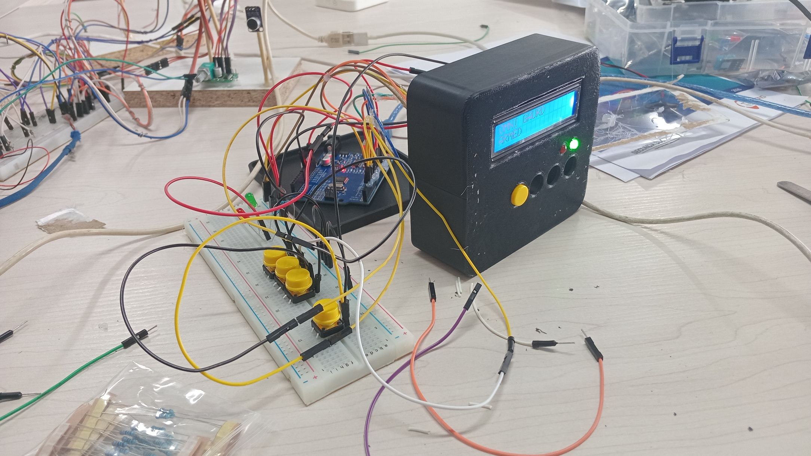

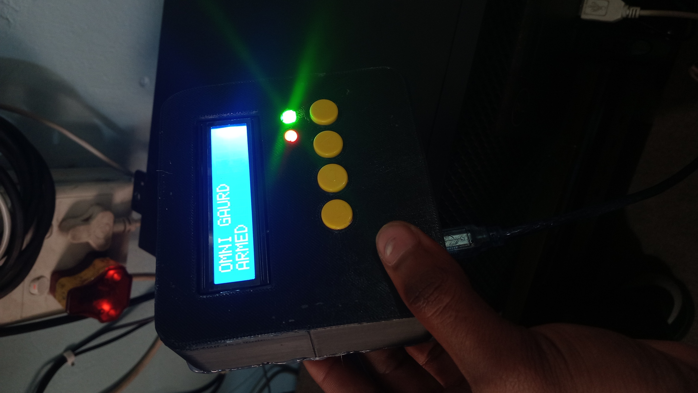

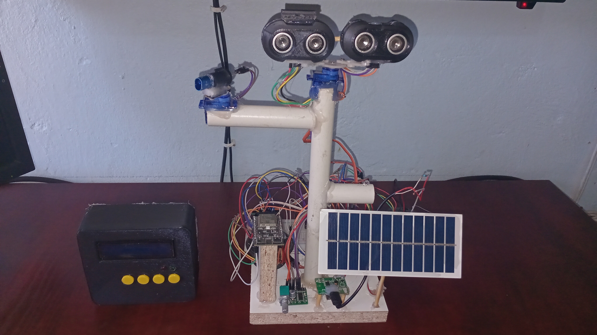

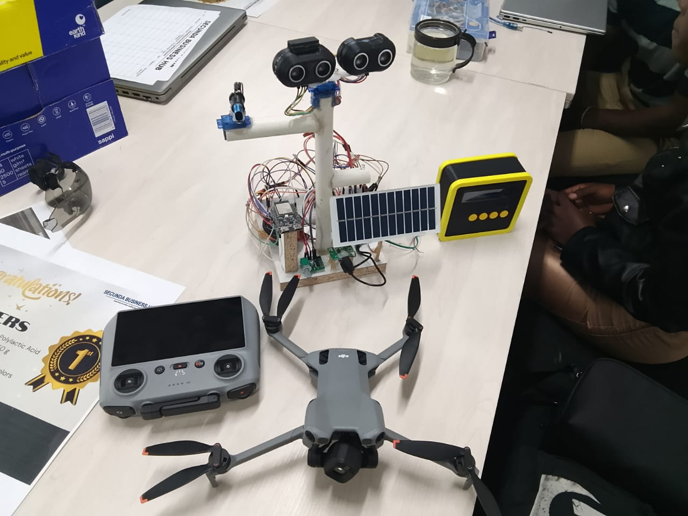
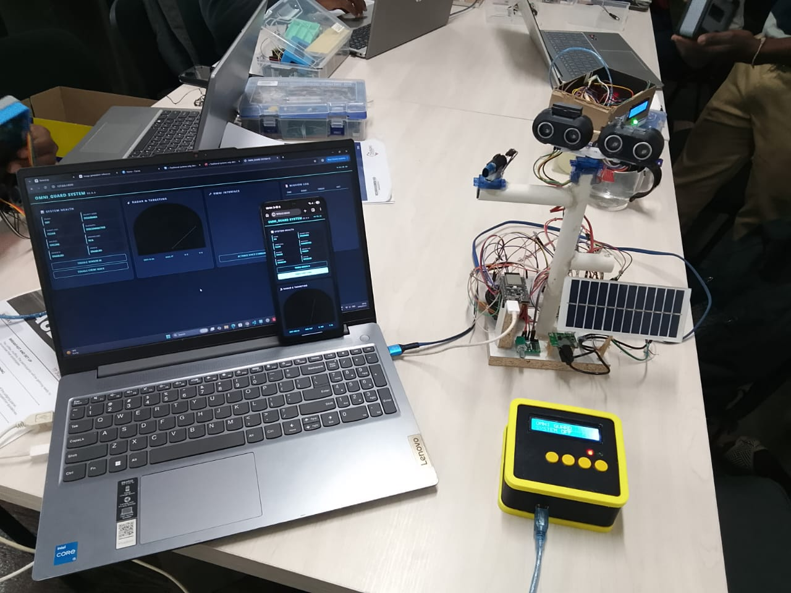

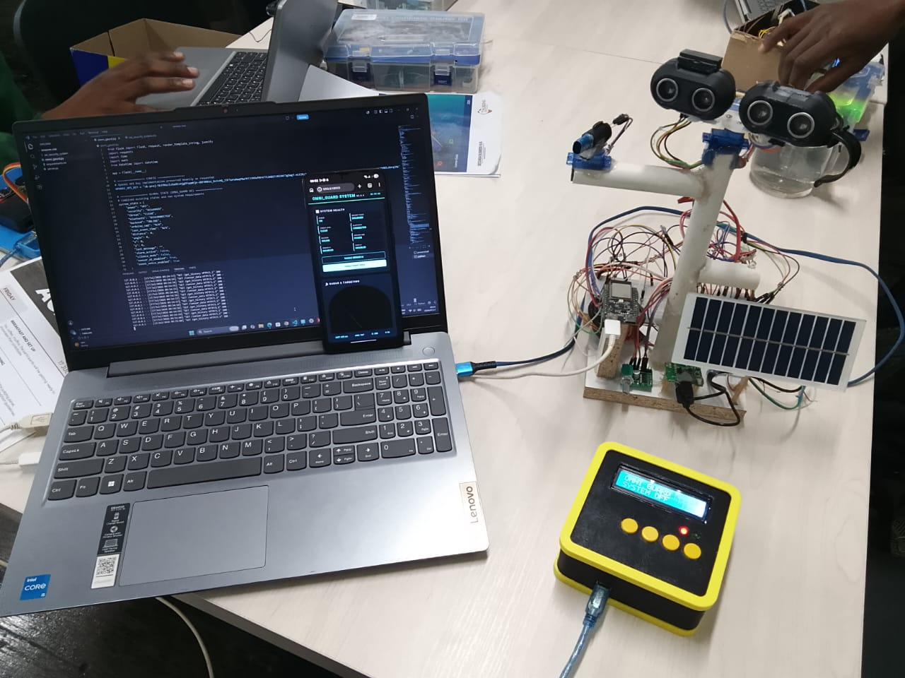


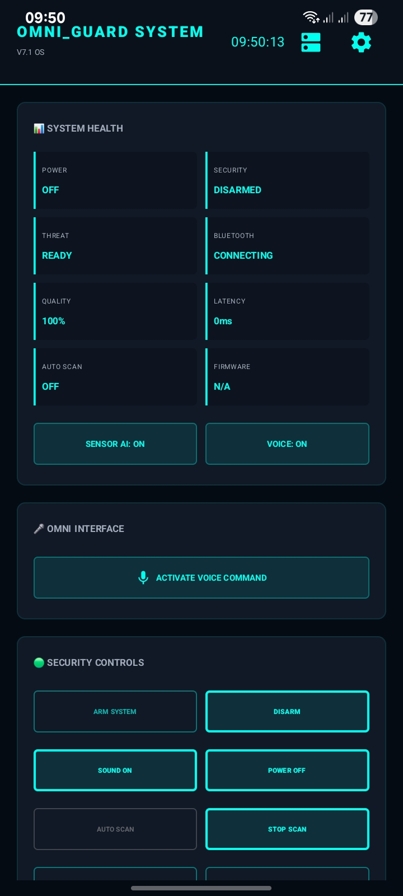

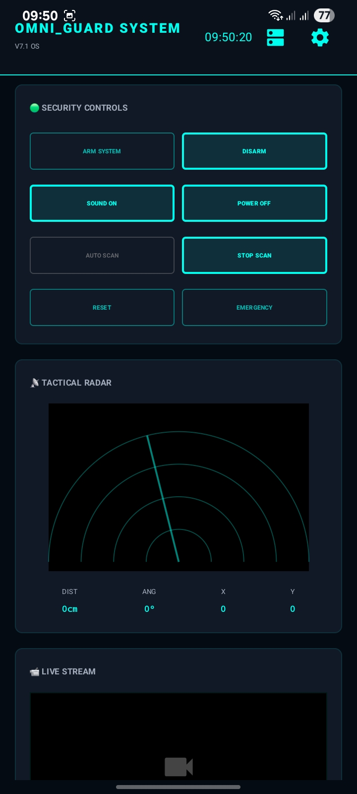

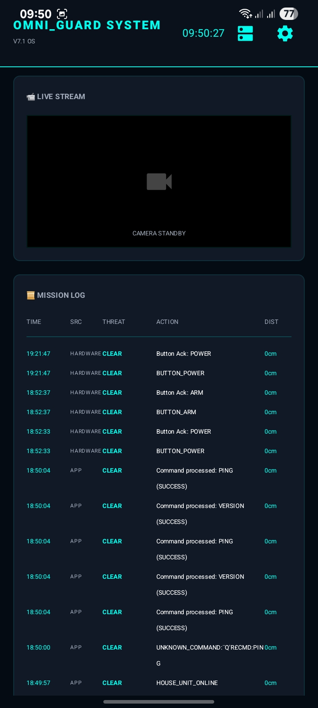

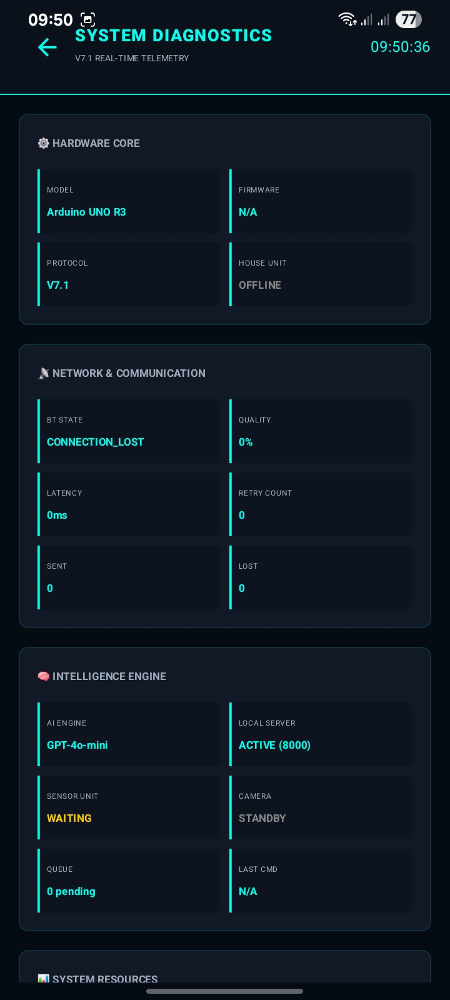

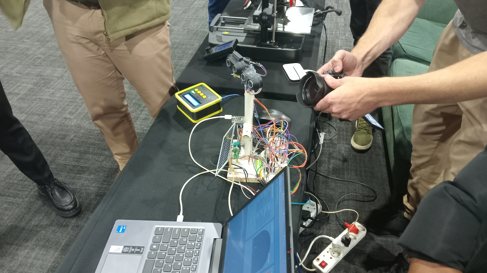

### Video


**End of Software Design Specification v1.0**
**Approved for Incubation.**
